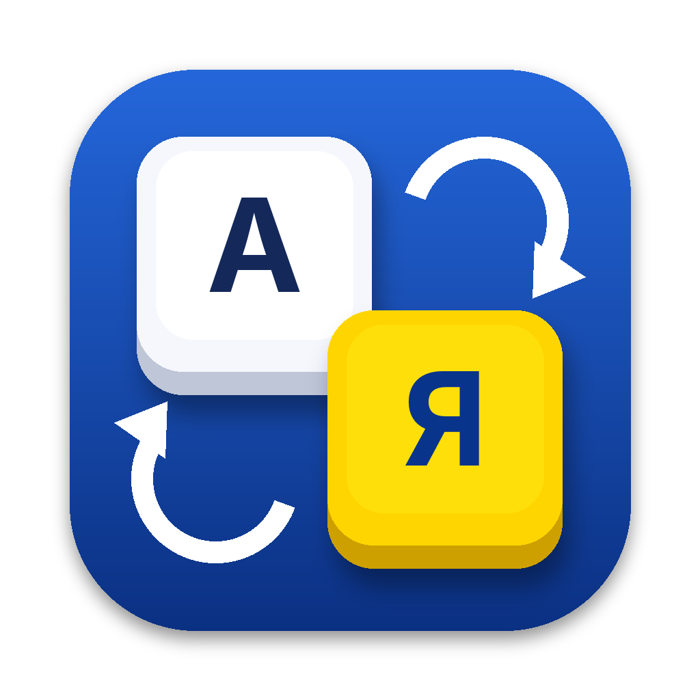

<p align="center"></p>

<h1 align="center">KBSwitch</h1>

<p align="center">Fixes words typed in the wrong keyboard layout, English ⇄ Ukrainian, on <b>macOS</b> and <b>Windows</b>.<br>
<code>ghbdsn</code> + Space → <code>привіт</code> · <code>руддщ</code> + Space → <code>hello</code></p>

A tiny app that lives in the menu bar (macOS) or the system tray (Windows), with the **ЯR** icon.
It uses no CPU while idle, makes no network requests and starts automatically when you log in.

- **macOS:** [install](#macos), a native Swift app in [`macos/`](macos)
- **Windows:** [install](#windows), a native C++ app in [`windows/`](windows)

Both versions work the same way and share the same settings format. Both use [Hunspell](hunspell)
with the LibreOffice English and Ukrainian dictionaries.

---

## Windows

Windows 10 or 11. You need both an **English** and a **Ukrainian** keyboard layout
(*Settings → Time & language → Language & region*).

1. Download **KBSwitch-Windows.zip** from the
   [latest release](https://github.com/dzhusjr/Keyboard-Switcher/releases/latest).
2. Unzip it and double-click **KBSwitch.exe**.
   - If Windows says *"Windows protected your PC"*, click **More info → Run anyway**. The app isn't
     signed by a paid certificate, so you only see this the first time.
3. That's it. KBSwitch installs itself into `%LOCALAPPDATA%\Programs\KBSwitch`, adds itself to the
   Start menu, starts with Windows, and shows the **ЯR** icon in the tray. You can delete the zip and
   the unzipped folder.

There's no permission to grant on Windows.

**Update:** download the new zip and run its `KBSwitch.exe`. It replaces the installed copy, and your
settings stay.<br>
**Uninstall:** right-click the **ЯR** tray icon → **Uninstall…**

<details>
<summary>Build it yourself</summary>

Needs Visual Studio Build Tools ("Desktop development with C++") and CMake. In PowerShell:

```powershell
git clone https://github.com/dzhusjr/Keyboard-Switcher.git
cd Keyboard-Switcher\windows
.\build.ps1
```

This produces `windows\dist\KBSwitch-Windows.zip`. Then continue at step 2 above.
</details>

---

## macOS

macOS 13 or newer. You need both an **ABC/U.S.** and a **Ukrainian** keyboard layout
(*System Settings → Keyboard → Input Sources*).

**1. Install Apple's command-line tools** (skip if you already have Xcode or the tools):

```bash
xcode-select --install
```

**2. Get the code and build the app:**

```bash
cd /tmp && git clone https://github.com/dzhusjr/Keyboard-Switcher.git && cd Keyboard-Switcher/macos && ./build.sh
```

`build.sh` compiles the app, installs it to **/Applications/KBSwitch.app** and opens it. The first
build also downloads the dictionary and compiles Hunspell; both are cached, so later builds take a
few seconds.

**3. Allow Accessibility (one time only):** when macOS asks, open *System Settings → Privacy &
Security → Accessibility* and switch **KBSwitch** on. It starts working within 2 seconds.

That's it. The **ЯR** icon appears in the menu bar, and the app starts automatically at every login.

**Update:** run the same command again. You won't be asked for Accessibility again, because every
build is signed with the same local certificate.<br>
**Uninstall:** run `./uninstall.sh` in the `macos` folder of a clone (the command above leaves one in
`/tmp/Keyboard-Switcher` until restart). It removes the app, its login item, its permission, its
settings and its signing keychain.

<details>
<summary>Without Xcode: share a ready-made app</summary>

On a Mac that has built it: `ditto -c -k --keepParent /Applications/KBSwitch.app ~/Desktop/KBSwitch.zip`.
Send the zip. The other person unzips it, drags **KBSwitch** to Applications, opens it, clicks **Open
Anyway** in *System Settings → Privacy & Security*, then allows Accessibility. Releases also contain
`KBSwitch-macOS.zip` built by GitHub. It works the same way, but asks for Accessibility again after
each update.
</details>

---

## Using it

Just type. When a word was typed in the wrong layout, pressing **Space** replaces it and switches
the layout.

- **Esc** right after a fix undoes it, and the word is never converted again. (You can pick Backspace
  as the undo key instead. A Backspace undo isn't remembered, since it's also plain editing.)
- **ЯR icon:** Enabled · Settings… · Diagnostic Log · Quit (and Uninstall… on Windows).

### Settings

Enable/disable, start at login, minimum/maximum word length, the undo key, a **Never convert** word
list and **Ignored apps** (terminals by default). Changes apply instantly.

**Optional: Ukrainian typed in Latin.** Turn on *Ukrainian typed in Latin → Cyrillic* and words like
`privit`, `dyakuyu` or `dobryi` become **привіт**, **дякую**, **добрий** when you press Space. Words that
are also English (`yak`, `tak`) are converted only in context: right after a converted word, or together
with the next word once that one converts (`yak spravy` → **як справи**). It keeps your layout, and the
undo key reverts it. Off by default.

**Optional: fix typos.** *Fix typos* has three settings: **Off** (default), **Careful** and **Smart**.

*Smart* (macOS for now) uses an offline language model of English and Ukrainian (word frequencies,
slang included, and which words follow which; see [model/SOURCES.md](model/SOURCES.md)) plus a
model of how people mistype on a keyboard. It fixes badly mangled words using the word before
(`ckasroom` → **classroom**, `зроблю тобы` → **зроблю тобі**), and when the next word arrives it
looks again at a previous word it left alone, now with context on both sides. It never changes a
word that is in the dictionary or one you write often (slang such as `норм`, `кринж` or `lol` stays),
and it only corrects when one answer is clearly ahead. On test text it fixed 78% of English typos with
1.4% wrong fixes and changed 0.1–0.4% of correctly spelled words. A check takes about 0.4 ms and
the data uses about 20 MB of memory, loaded only when Smart is on. Words in *Never convert* and words
whose correction you undo are learned.

*Careful*: a word that isn't a word in either language, but is
one common slip away from exactly one word, is corrected when you press Space: two letters swapped
(`implemnet` → **implement**), a neighbouring key inside a 5+ letter word (`hwllo` → **hello**), a
doubled letter or a double typed once (`adress` → **address**, `приивіт` → **привіт**). It also works
when the word was typed in the wrong layout as well. To avoid "correcting" what you meant, it leaves
alone words under 4 letters, anything capitalized (names), anything with digits or symbols, stretched
words (`hmmm`, `ахааа`) and every case with more than one possible word. Esc undoes a correction and
remembers the word. Off by default.

If a word isn't fixed and you don't know why, choose **Diagnostic Log** in the menu, reproduce it,
then choose **Show Log**. Every key, every forgotten word and every skipped fix is logged with its
reason. The log contains what you typed, so turn it off afterwards.

### When does it replace a word?

Only when **all** of these are true, so it never deletes or adds the wrong text:

1. You pressed Space right after typing the word key by key. Shortcuts, arrows, held keys, mouse
   clicks or switching apps throw the word away.
2. What you typed is **not** a real word, but the same keys in the other layout **are** a real word.
3. It isn't in your exceptions and its length is within your limits.
4. The cursor is in an editable, non-password text field, and the text right before it is exactly
   that word.

It then deletes exactly the characters you typed, types the converted word and switches the layout.
Words right before it (up to 3) that were typed in the same wrong layout and left alone because they
also looked fine (one-letter words like `s` → **і**, `d` → **в**, or words valid in both languages) are
converted along with it. This only happens if KBSwitch hadn't already changed them and the text field
shows exactly those words.

On Windows, the text field is read through UI Automation (Notepad, Word, browsers, Telegram, most
apps). In apps that don't expose their text, KBSwitch does nothing rather than guess. It also can't
type into apps running as administrator.

---

## Repository

- `macos/`: `kbswitch.swift` (single file: AppKit, Carbon, Accessibility), `build.sh`, `uninstall.sh`, icons
- `windows/`: `kbswitch.cpp` (single file: Win32, low-level keyboard hook, UI Automation), `CMakeLists.txt`, `build.ps1`, icons
- `hunspell/`: Hunspell 1.7.2 sources (MPL/GPL/LGPL), shared by both
- `.github/workflows/build.yml`: builds both on every push. Pushing a tag like `v2.1` publishes a
  release with `KBSwitch-macOS.zip` and `KBSwitch-Windows.zip`.

Dictionaries are downloaded at build time from
[LibreOffice/dictionaries](https://github.com/LibreOffice/dictionaries) (`en_US`, `uk_UA`).

The original Windows/Python script (`main.pyw`) is still in the repository root.
